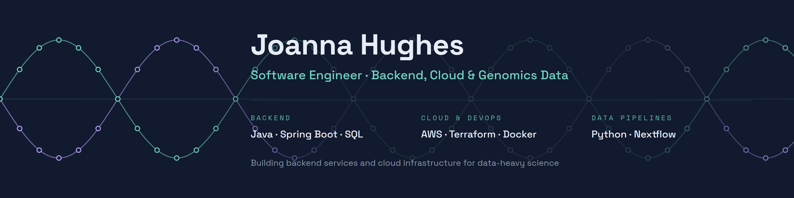
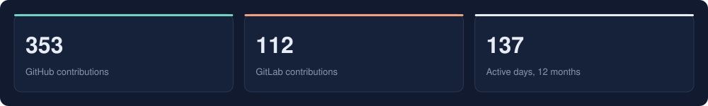
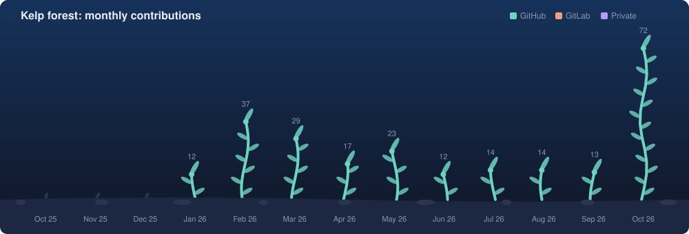
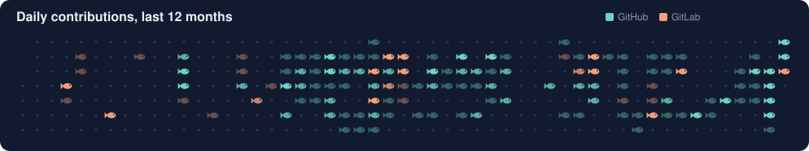

  

  

## Degrees

- M.S. Computer Science, University of the Pacific, 2025
- B.S. Computer Engineering, University of the Pacific, 2025

## Stats

  

All time: 410 on GitHub (since 2021) · 0 on GitLab (since 2026)

  

  

## Projects

|  | Category | Highlights | |
|---|---|---|---|
|  | **Genomics & bioinformatics** | PACER long-read pipeline, equine long-read research | [6 projects →](https://github.com/JoannaKHughes/JoannaKHughes/blob/main/projects/genomics.md) |
|  | **Cloud & infrastructure** | AWS Batch, EC2 and S3 with Terraform | [6 projects →](https://github.com/JoannaKHughes/JoannaKHughes/blob/main/projects/cloud.md) |
|  | **Genotyping arrays & parentage** | SNP array tools, pedigree builder | [4 projects →](https://github.com/JoannaKHughes/JoannaKHughes/blob/main/projects/genotyping.md) |
|  | **Web, backend & other software** | WHALE lab web app, VGL chatbot, ML phishing detection | [7 projects →](https://github.com/JoannaKHughes/JoannaKHughes/blob/main/projects/software.md) |
|  | **Embedded & hardware** | MP3 player, FPGA tail lights, smart wheelchair | [4 projects →](https://github.com/JoannaKHughes/JoannaKHughes/blob/main/projects/embedded.md) |

Updated 2026-10-17 · generated by <code>scripts/build_profile.py</code>
